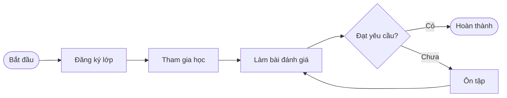

# Bài 2: Chuẩn bị hồ sơ dự án trước khi triển khai hệ thống

**Dự án:** PTIT-Learning — Module Học trực tuyến, tính năng Lớp học ảo.

Hồ sơ gồm khung đặc tả yêu cầu, phương án tổ chức dữ liệu và nội dung slide giới thiệu tính năng. Các bảng dữ liệu nhỏ dưới đây là ví dụ minh họa cho cách thực hiện.

## Phần 1. Phân tích

### Cấu trúc Heading của SRS

SRS cần giúp người đọc tìm nhanh yêu cầu và giúp nhóm phát triển biết rõ phần việc cần triển khai. Em tổ chức tài liệu thành một tiêu đề cấp 1, đúng **10 tiêu đề cấp 2**; riêng yêu cầu chức năng được chia tiếp theo nhóm nghiệp vụ.

```text
Heading 1: SRS — Module Học trực tuyến
├── Heading 2: 1. Mục đích tài liệu
├── Heading 2: 2. Phạm vi hệ thống
├── Heading 2: 3. Người sử dụng và phân quyền
├── Heading 2: 4. Quy trình nghiệp vụ
├── Heading 2: 5. Yêu cầu chức năng (Functional Requirements)
│   ├── Heading 3: 5.1. Quản lý lớp học
│   ├── Heading 3: 5.2. Tham gia và tương tác
│   ├── Heading 3: 5.3. Điểm danh và chuyên cần
│   └── Heading 3: 5.4. Bài tập và kết quả học tập
├── Heading 2: 6. Dữ liệu và quy tắc nghiệp vụ
├── Heading 2: 7. Yêu cầu phi chức năng
├── Heading 2: 8. Giao diện và tích hợp
├── Heading 2: 9. Tiêu chí nghiệm thu
└── Heading 2: 10. Giả định và ràng buộc
```

Khi đưa phần SRS vào Word, áp dụng **Heading 1/2/3** theo sơ đồ, sau đó mở **View → Navigation Pane → Headings** để kiểm tra đủ 10 mục cấp 2 và đúng thứ tự. Các tiêu đề phải nằm trong phần thân tài liệu; chỉ tăng cỡ chữ hoặc in đậm sẽ không thay thế được Heading Style. [Hướng dẫn Navigation Pane của Microsoft](https://support.microsoft.com/en-us/word/use-the-navigation-pane-in-word).

## Phần 2. Triển khai

### 2.1. Nội dung SRS cho tính năng Lớp học ảo

**1. Mục đích tài liệu**

Thống nhất yêu cầu giữa nhóm sản phẩm, lập trình viên và kiểm thử viên trước khi xây dựng lớp học ảo trên PTIT-Learning.

**2. Phạm vi hệ thống**

Phiên bản đầu hỗ trợ tạo lớp, lên lịch, tham gia buổi học, trao đổi, điểm danh và nộp bài. Thanh toán học phí và cấp chứng chỉ tự động chưa thuộc phạm vi này.

**3. Người sử dụng và phân quyền**

- **Sinh viên:** tham gia lớp đã đăng ký, xem tài liệu, nộp bài và xem kết quả của mình.
- **Giảng viên:** quản lý lớp được phân công, giao bài, chấm bài và xác nhận chuyên cần.
- **Quản trị viên:** quản lý tài khoản, khóa học và phân công giảng viên.

**4. Quy trình nghiệp vụ**

Sinh viên đăng nhập → chọn khóa học → đăng ký lớp → tham gia buổi học → làm bài tập → xem kết quả. Hệ thống kiểm tra quyền vào lớp trước khi cho tham gia và lưu tiến độ sau mỗi hoạt động.

**5. Yêu cầu chức năng — Functional Requirements**

| Phân vùng | Mã | Yêu cầu |
|---|---|---|
| 5.1. Quản lý lớp học | FR-01 | Giảng viên tạo hoặc sửa lịch lớp được phân công; thời gian kết thúc phải sau thời gian bắt đầu. |
| 5.1. Quản lý lớp học | FR-02 | Sinh viên đăng ký lớp còn chỗ; hệ thống từ chối đăng ký trùng một lớp. |
| 5.2. Tham gia và tương tác | FR-03 | Chỉ người có quyền trong lớp được vào buổi học; người chưa đăng ký nhận thông báo từ chối. |
| 5.2. Tham gia và tương tác | FR-04 | Người tham gia gửi tin nhắn, giơ tay; giảng viên chia sẻ màn hình và điều hành buổi học. |
| 5.3. Điểm danh và chuyên cần | FR-05 | Hệ thống ghi nhận thời điểm vào, ra và tổng thời lượng tham gia của từng sinh viên. |
| 5.3. Điểm danh và chuyên cần | FR-06 | Giảng viên xác nhận hoặc điều chỉnh chuyên cần; mỗi lần sửa phải lưu lý do và người thực hiện. |
| 5.4. Bài tập và kết quả học tập | FR-07 | Sinh viên nộp bài và thay thế bài trước hạn; hệ thống lưu thời điểm nộp gần nhất. |
| 5.4. Bài tập và kết quả học tập | FR-08 | Giảng viên nhập điểm, nhận xét và công bố kết quả; sinh viên chỉ xem được kết quả của mình. |

**6. Dữ liệu và quy tắc nghiệp vụ**

Dữ liệu chính gồm sinh viên, khóa học, lớp học, đăng ký, buổi học, điểm danh và bài nộp. Mỗi đối tượng có mã riêng; một khóa học có thể mở nhiều lớp. Một sinh viên chỉ có một bản ghi đăng ký trong cùng một lớp.

Điểm chuyên cần nằm trong khoảng **0–10**; ô trống có nghĩa là chưa có điểm, không được tự đổi thành 0. Khi nhập dữ liệu từ website, biểu mẫu hoặc phòng đào tạo, cần chuẩn hóa tên, mã khoa và lưu nguồn đăng ký. Đối chiếu trùng bằng **mã sinh viên + mã lớp**, không dùng họ tên.

**7. Yêu cầu phi chức năng**

Các ngưỡng đề xuất cho phiên bản đầu: lớp học hỗ trợ 100 người đồng thời; 95% yêu cầu tải danh sách lớp phản hồi trong 3 giây ở mức tải này, không tính luồng video. Truy cập phải được kiểm tra quyền ở phía máy chủ; kết nối dùng HTTPS. Khi mất mạng, hệ thống báo trạng thái và cho phép kết nối lại mà không cộng trùng thời lượng điểm danh.

**8. Giao diện và tích hợp**

Giao diện có ba màn hình chính: danh sách lớp, phòng học và kết quả học tập. Phòng học hiển thị rõ nút vào/rời lớp, micro, camera, trò chuyện và giơ tay. Dịch vụ họp trực tuyến được tích hợp qua API; khi dịch vụ lỗi, hệ thống hiển thị thông báo và hướng dẫn thử lại.

**9. Tiêu chí nghiệm thu**

Mỗi FR có ca kiểm thử tương ứng và phải đạt trước khi bàn giao. Các tình huống trọng tâm gồm: chặn đăng ký trùng; chặn người ngoài lớp; cộng đúng thời lượng qua nhiều lần kết nối; lưu lý do sửa chuyên cần; xử lý đúng hạn nộp bài; không để sinh viên xem điểm của người khác. Các ngưỡng hiệu năng ở mục 7 cần được đo bằng kiểm thử tải.

**10. Giả định và ràng buộc**

Người dùng có tài khoản và Internet; giảng viên đã được phân công lớp. Cách quy đổi thời lượng tham gia thành điểm chuyên cần phải được bộ phận đào tạo thống nhất trước khi triển khai. Các ngưỡng hiệu năng nêu trên là mục tiêu đề xuất, chưa phải kết quả đo thực tế.

**Hoàn thiện tài liệu Word:** tạo mục lục tự động từ Heading. Sau khi sửa xong, chọn **References → Update Table → Update entire table → OK**, kiểm tra lại tiêu đề và số trang rồi mới lưu. Lựa chọn này cập nhật cả nội dung tiêu đề lẫn số trang. [Hướng dẫn cập nhật mục lục của Microsoft](https://support.microsoft.com/en-us/word/update-a-table-of-contents).

### 2.2. Tổ chức và lọc dữ liệu Excel

Đề bài có hai nhóm dữ liệu khác nhau, vì vậy workbook được bố trí thành hai sheet:

| Sheet | Cấu trúc dữ liệu |
|---|---|
| `KhoaHoc` | 200 khóa học ở hàng 2–201; các cột A–F: Mã khóa học, Tên khóa học, Khoa, Cấp độ, Hình thức, Trạng thái. |
| `DangKy` | Các cột A–F: Mã sinh viên, Họ tên, Khoa, Mã lớp, Điểm chuyên cần, Nguồn đăng ký. Mỗi hàng là một lượt đăng ký lớp. |

**Quy tắc bố trí:** hàng 1 là Header Row duy nhất trên mỗi sheet. Không đặt tên báo cáo phía trên header, không gộp ô, không chèn hàng trắng hoặc hàng tổng cộng giữa dữ liệu. Điểm phải được lưu dạng số; phần tổng hợp đặt ở sheet riêng.

**Lọc danh sách 200 khóa học:** chọn `KhoaHoc!A1:F201`, nhấn **Ctrl + Shift + L** để bật AutoFilter. Lần lượt lọc **Khoa = CNTT**, **Cấp độ = Cơ bản**, **Trạng thái = Đang mở**. Kết quả chỉ gồm các khóa học thỏa mãn đồng thời ba điều kiện.

**Lọc sinh viên cần theo dõi chuyên cần:**

1. Chọn toàn bộ vùng dữ liệu của `DangKy`, gồm cả header; nhấn **Ctrl + Shift + L** nếu chưa bật bộ lọc.
2. Ở cột **Khoa**, chỉ chọn `CNTT`.
3. Ở cột **Điểm chuyên cần**, chọn **Number Filters → Less Than**, nhập `7`; loại ô trống khỏi kết quả.
4. Kiểm tra các dòng còn lại đều thuộc CNTT và có điểm **nhỏ hơn 7**, không bao gồm điểm bằng 7.

Các bộ lọc trên những cột khác nhau kết hợp theo điều kiện **AND**. Phím tắt chỉ bật/tắt AutoFilter; điều kiện lọc được đặt tại từng cột. [Lọc dữ liệu trong Excel](https://support.microsoft.com/en-us/excel/get-started/filter-data-in-a-range-or-table-in-excel), [phím tắt Excel](https://support.microsoft.com/en-us/accessibility/excel/keyboard-shortcuts-in-excel).

Ví dụ kiểm tra điều kiện:

| Mã sinh viên | Họ tên | Khoa | Điểm chuyên cần | Kết quả dự kiến |
|---|---|---|---:|---|
| SV001 | Nguyễn Văn An | CNTT | 6,5 | Hiển thị |
| SV002 | Trần Thu Hà | CNTT | 7,0 | Ẩn |
| SV003 | Lê Minh Đức | QTKD | 5,5 | Ẩn |
| SV004 | Phạm Ngọc Mai | CNTT | 4,0 | Hiển thị |
| SV005 | Vũ Hoàng Nam | CNTT | Chưa có điểm | Ẩn; ô điểm thực tế để trống |

Nếu một sinh viên đăng ký nhiều lớp, kết quả có thể xuất hiện nhiều dòng cho người đó. Vì vậy, số dòng lọc được không nhất thiết bằng số sinh viên.

### 2.3. Slide giới thiệu tính năng và lộ trình học tập

Slide dùng tỷ lệ **16:9**, chia thành ba vùng rõ ràng:

| Vùng | Tỷ lệ chiều cao | Nội dung |
|---|---:|---|
| Tiêu đề | 20% | **PTIT-Learning — Lớp học ảo**; dòng phụ: “Học trực tiếp, theo dõi tiến độ, kết nối cùng giảng viên”. |
| Nội dung chính | 65% | Flowchart lộ trình học, với nhánh đánh giá đạt/chưa đạt. |
| Chân trang | 15% | “Tương tác trực tiếp • Điểm danh rõ ràng • Kết quả tập trung”; tên dự án và số slide. |



Khi dựng trên PowerPoint, dùng hình bo tròn cho bắt đầu/kết thúc, hình chữ nhật cho hoạt động và hình thoi cho quyết định. Nối bằng Connector có mũi tên; đặt nhánh ôn tập bên dưới để tránh đường nối cắt nhau. Điều kiện đạt do giảng viên công bố cho từng khóa học.

Màu nền **Navy `#102A43`**, chữ **trắng `#FFFFFF`**, Accent **cam `#FF9F1C`**. Chữ trắng trên nền Navy có tỷ lệ tương phản khoảng **14,64:1**; cam trên Navy khoảng **7,13:1**. Với ô tô cam, dùng chữ Navy; chữ trắng trên cam chỉ đạt khoảng **2,05:1**. Các tỷ lệ được tính theo công thức tương phản của W3C; lấy **4,5:1** làm ngưỡng tham chiếu cho chữ thường. [Hướng dẫn tương phản W3C](https://www.w3.org/WAI/WCAG21/Understanding/contrast-minimum).

Tiêu đề dùng cỡ 32–36 pt, nội dung 20–24 pt. Mỗi ô chỉ giữ một ý ngắn; căn đều các hình và dùng cam để nhấn bước quyết định.

## Phần 3. Kiểm thử

### 3.1. Lọc theo tên không ra kết quả

Tên nhập từ nhiều nguồn có thể chứa khoảng trắng đầu, cuối hoặc nhiều khoảng trắng giữa các từ. Chẳng hạn, ô B2 chứa ` Nguyễn  Văn An ` sẽ không khớp với điều kiện **Text Filters → Equals → Nguyễn Văn An**.

Cách xử lý:

1. Xóa các điều kiện lọc đang áp dụng để kiểm tra toàn bộ dữ liệu.
2. Thêm cột G với tiêu đề `Họ tên chuẩn hóa`. Tại G2, nhập:

   ```excel
   =TRIM(B2)
   ```

3. Kéo công thức đến cuối danh sách. Kết quả ví dụ sẽ thành `Nguyễn Văn An`.
4. Kiểm tra, sao lưu cột tên gốc rồi sao chép cột G và **Paste Special → Values** vào cột B. Lọc lại theo tên và các điều kiện cần dùng.

Nếu dữ liệu sao chép từ web có khoảng trắng không ngắt dòng, `TRIM` đơn lẻ chưa xử lý được. Khi đó dùng:

```excel
=TRIM(SUBSTITUTE(B2,CHAR(160)," "))
```

`TRIM` xử lý khoảng trắng thông thường; `SUBSTITUTE` trong công thức trên đổi ký tự khoảng trắng mã 160 thành khoảng trắng thường trước khi làm sạch. Nếu Excel dùng dấu chấm phẩy để phân tách đối số, thay dấu phẩy bằng `;`. [Tài liệu hàm TRIM của Microsoft](https://support.microsoft.com/en-us/excel/functions/trim-function).

Nếu vẫn không tìm thấy tên, kiểm tra vùng AutoFilter đã bao phủ dòng đó chưa và còn điều kiện lọc nào đang ẩn dòng hay không. Không mặc định mọi lỗi tìm tên đều do khoảng trắng.

### 3.2. Danh sách kiểm tra trước khi nộp

| Hạng mục | Điều kiện đạt |
|---|---|
| SRS | Navigation Pane hiển thị đúng 10 Heading 2; Functional Requirements chia nhóm rõ ràng. |
| Mục lục Word | Đã chọn **Update entire table** sau lần sửa cuối, trước khi lưu. |
| Dữ liệu Excel | Có đủ 200 khóa học; mỗi sheet dữ liệu chỉ có một header ở hàng 1, không có tổng cộng chen giữa. |
| Lọc sinh viên | Chỉ còn CNTT có điểm dưới 7; loại điểm bằng 7 và ô chưa có điểm. |
| Làm sạch tên | Tên sau TRIM khớp với điều kiện lọc; dữ liệu gốc được giữ để đối chiếu. |
| Slide | Đủ ba vùng, đúng Navy–trắng–cam; flowchart có nhánh đạt/chưa đạt và chữ dễ đọc. |

Đây là tiêu chí kiểm tra khi thực hiện trên Word, Excel và PowerPoint; bản Markdown trình bày nội dung báo cáo, không thay thế bằng chứng thao tác trên các ứng dụng.
